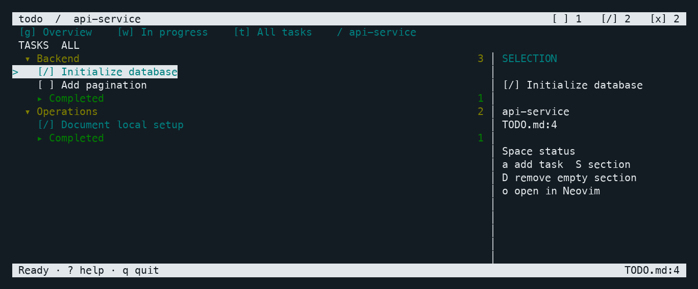

# todox

A keyboard-driven, Markdown-native todo app for the terminal. Tasks stay in `TODO.md`; there is no database or cloud account. Built directly with [OpenTUI Core](https://github.com/anomalyco/opentui) and [Bun](https://bun.sh/).

The command is **`todo`**.



*Screenshot generated from the included sample project using OpenTUI's native test renderer and a dark terminal palette. Your terminal colors may differ.*

## Install

Requires Bun and a terminal. Neovim is optional for the `o` shortcut.

```sh
git clone https://github.com/Hassibayub/todox.git
cd todox
npm ci
bun link
```

`bun link` installs `todo` under `~/.bun/bin`. If your shell cannot find it, add that directory to your `PATH`. Keep the cloned directory: the command links to its source files. After moving the directory, run `bun link` again from its new location.

To try it without installing the command, run `bun run demo` from the clone. The demo uses only the included sample projects and an isolated registry.

## Use

```sh
cd your-project
todo init                         # create TODO.md here, without overwriting an existing file
todo                              # open the nearest TODO.md

todo add-project ~/code/my-app     # register an existing TODO.md
todo scan ~/code                   # register immediate child projects
todo --global                      # overview from any directory
todo projects                      # list registered files
todo stats --json                  # counts for scripts
```

With no local `TODO.md`, `todo` opens the global overview. A local file is registered on first visit. The project list is stored in `~/.config/todox/projects.json` (or `$XDG_CONFIG_HOME/todox/projects.json`); override it with `TODOX_CONFIG`. Each project's `TODO.md` is always the source of task data.

Tasks use `[ ]` for not started, `[/]` for in progress and `[x]` for completed. Existing notes, comments, formatting, line endings and unrelated Markdown are preserved when editing tasks.

### Keys

| Keys | Action |
|---|---|
| `j/k`, arrows, Home/End, Ctrl+d/u | Move or page |
| Tab | Switch navigation/list focus |
| `g`, `w`, `t` | Overview, in-progress queue, all tasks |
| `p` | Choose project or scope |
| Enter | Open a project or fold a group |
| Space, `1/2/3` | Cycle or set task status |
| `a/e/d` | Add/edit/delete task; `y` confirms deletion |
| `S/D` | Create section / remove empty section; `y` confirms |
| `/`, `f` | Search / filter by status |
| `za`, `zM`, `zR` | Fold current group / collapse all / expand all |
| `o` | Open selected file and line in Neovim |
| `r`, Escape, `?`, `q` | Refresh, cancel/reset, help, quit |

Section removal is **empty-only**: tasks, notes, comments, code blocks and nested headings block it. The document title and implicit General group are protected. Writes use cooperative locks, atomic replacement and stale-file checks to avoid overwriting external changes.

The UI uses your terminal's default foreground/background and ANSI palette, so it follows light or dark terminal themes without an app setting. The layout fits compact terminals; at 104+ columns, an inspector shows the current selection. Completed tasks fold in the unfiltered view, while search and filters reveal matches. There is no automatic file watcher, undo, cloud sync or packaged standalone binary.

## Develop and test

```sh
bun run typecheck
bun test
python3 scripts/pty_smoke.py
```

Tests and the PTY smoke check use temporary files, not your registered projects. `scripts/capture.ts` generates read-only text frames under the ignored `.pi/review/` directory.

MIT licensed. See [LICENSE](LICENSE).
